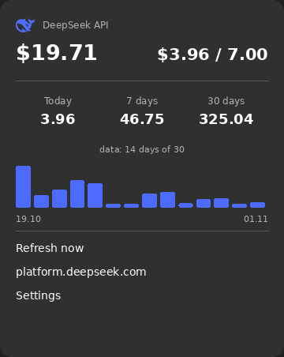

# deepmon — DeepSeek API balance and spending in GNOME Shell

A GNOME Shell 50 extension: the account balance and today's spending in the top
bar, a popup with today/7/30-day totals and a per-day chart, and a notification
when the daily spending limit is crossed. Distributed as a `.deb` package, with
the API key kept in the GNOME keyring.




> The images above are rendered by `docs/render_previews.py` from the real
> history file: GNOME Shell's screenshot interface is restricted for third
> parties on Wayland, so they show the same strings, numbers and geometry the
> popup draws instead of a screen capture.

## Where the numbers come from

DeepSeek exposes a single public endpoint — `GET https://api.deepseek.com/user/balance`.
There is no public usage history, so spending is derived from **balance deltas
between polls**: every 15 minutes a snapshot is stored and consecutive pairs give
the spend. An increase in balance is booked as a top-up, never as negative
spending.

Precision therefore equals the polling interval: a day with a gap (laptop asleep,
session closed) is marked `≈` and shown as approximate.

A more accurate source is optional: with a **platform web session token** the
extension imports per-day costs from the private dashboard endpoint
`GET https://platform.deepseek.com/api/v0/usage/by_api_key/cost` and those values
take precedence over local deltas — so today's figure matches the website even if
the extension started mid-day.

## Install

```sh
sudo apt install ./gnome-shell-extension-deepmon_<version>_all.deb
# extension directories are scanned at session start: log out and back in
```

Depends on `gnome-shell (>= 50)`, `gjs`, `gir1.2-secret-1`; `gnome-keyring` is
recommended. The gsettings schema and an override enabling the extension are
installed system-wide.

Removal: `apt remove gnome-shell-extension-deepmon`. The history in
`~/.local/state/deepmon/history.json` and the keyring entries are kept.

## Secrets

```sh
deepmon-key set              # API key, hidden input, stored in the keyring
deepmon-key set --platform   # platform session token (optional, enables history import)
deepmon-key status           # source and fingerprint of both secrets
deepmon-key delete [--platform]
pass show deepseek | deepmon-key set --stdin
```

- API key: keyring item with `application=deepmon`, `account=deepseek-api`;
  fallback file `~/.config/deepmon/key` with mode `0600`. A file with wider
  permissions is **not read** — the popup asks for `chmod 600`.
- Platform token: `account=deepseek-platform`. Get it from
  `platform.deepseek.com` → DevTools → Application → Local Storage → `userToken`.
  It grants full access to the account and can be removed with
  `deepmon-key delete --platform`.
- Neither secret is ever printed, logged, passed as an argument or written to
  gsettings; only a `sha256` fingerprint and the last characters are shown.
- An expired platform token is detected (`40002`/`40003`, HTTP 401/403): polling
  stops until the token changes, the popup explains what to run, and one
  notification is raised.

## Settings

| Key | Meaning | Default |
|---|---|---|
| `refresh-minutes` | polling interval | 15 |
| `daily-limit` | daily limit in the accounting currency, `0` disables | 1.0 |
| `daily-limit-enabled` | limit notifications | true |
| `currency` | accounting currency, empty — auto | `''` |
| `panel-mode` | `both` / `balance` / `spend` | both |
| `chart-days` | chart length | 14 |
| `api-base-url` | API base (proxy, tests) | `https://api.deepseek.com` |
| `platform-base-url` | private dashboard base | `https://platform.deepseek.com` |
| `key-file` | fallback key file path | `''` → `~/.config/deepmon/key` |

```sh
gsettings set org.gnome.shell.extensions.deepmon daily-limit 0.5
gsettings set org.gnome.shell.extensions.deepmon currency USD
```

Changing the accounting currency does not mix data: the old history is renamed to
`history.json.archive-<currency>-<time>` and tracking restarts from the current
snapshot.

## Languages

Interface strings are English msgids in `src/deepmon@fstronin/strings.js`;
translations live in `po/`. Russian and Simplified Chinese ship today.

```sh
make po                                  # po/*.po → locale/<lang>/LC_MESSAGES/deepmon.mo
msgfmt --check -o /dev/null po/ru.po     # validate a catalog
LANGUAGE=zh_CN deepmon-key status        # check the CLI in another language
```

Adding a language: copy `po/ru.po` to `po/<lang>.po`, translate the `msgstr`
entries, run `make po`. `tests/i18n.test.js` fails when any string from
`strings.js` is missing from a catalog.

## Development

```sh
make test          # 119 domain/adapter/CLI tests (gjs, no shell)
make test-net      # 9 HTTP adapter tests against a local mock server
make verify-ui     # headless shell: no-key state, icon, menu, no actor leaks
make verify-e2e    # headless shell + mock API + key file: full cycle, history on disk
make verify-system # headless shell in the packaged layout (no schemas/ inside the extension)
make deb           # build the package (needs debhelper)
python3 docs/render_previews.py   # regenerate the README previews
```

Fast iteration without a package:

```sh
make dev-install   # copy into ~/.local/share/gnome-shell/extensions
make dev-remove    # remove the user copy (required before installing the .deb)
```

Module imports are cached for the session, so UI changes require a re-login.

## Limitations

- one account and one key; a session token is optional but grants full account
  access;
- no per-model or per-token breakdown — the API does not expose it;
- network errors never raise notifications, they are shown in the popup;
- spending precision equals the polling interval, days with gaps are marked `≈`;
- the platform cost endpoint is private and may change without notice.

## License

MIT. The whale logo is the favicon from `deepseek.com`, used to refer to the
service; the mark belongs to DeepSeek.
