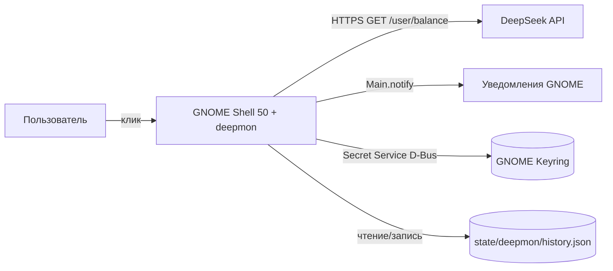
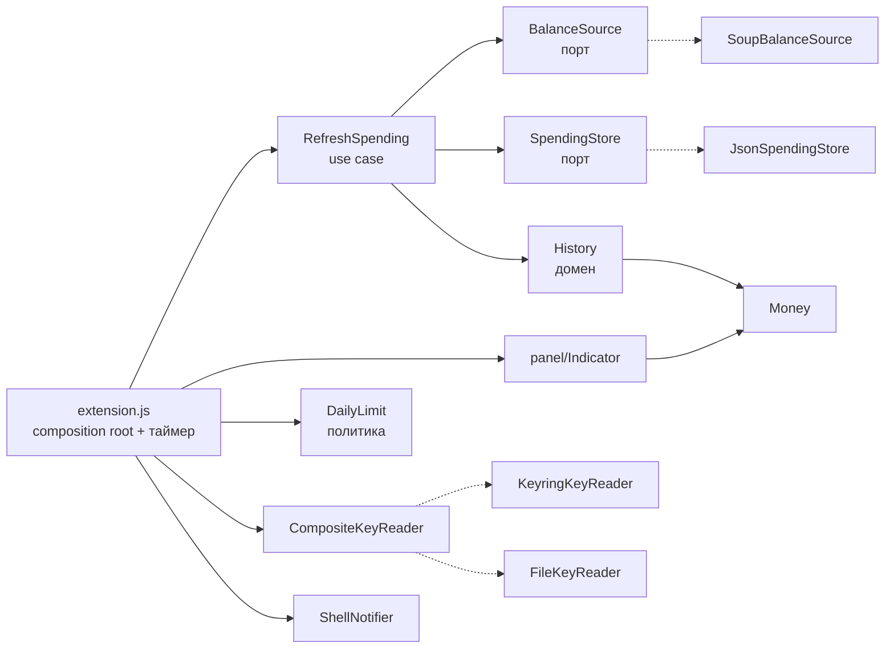

# deepmon — индикатор расходов DeepSeek API в GNOME Shell

- Дата: 2026-11-01
- Статус: дизайн утверждён пользователем, спека на ревью
- Поставка: deb-пакет `gnome-shell-extension-deepmon`

## 1. Задача

Дать пользователю постоянную видимость расходов на DeepSeek API: компактная сводка в
панели GNOME Shell, детали по клику и уведомление, когда расход за сегодня превысил
заданный порог. Установка — deb-пакет, хранение ключа — безопасное.

## 2. Границы

Входит в v1:

- опрос `GET /user/balance` по таймеру и при открытии меню;
- выбор валюты учёта: авто по ответу API или закреплённая в настройке;
- локальная история снапшотов баланса и дневные агрегаты;
- сводка: баланс, трата за сегодня / 7 дней / 30 дней, столбцы по последним N дням;
- уведомление о превышении дневного порога;
- настройки через prefs-окно (порог, интервал, режим панели, глубина графика);
- чтение ключа из GNOME Keyring с резервным файлом 0600 и CLI `deepmon-key`;
- deb-пакет со схемой gsettings, CLI и manpage;
- автотесты домена и адаптеров, headless-проверка UI, mock-сервер для сети.

Не входит в v1:

- расчёт стоимости по токенам и разбивка по моделям (публичного API использования нет);
- несколько аккаунтов и несколько ключей одновременно;
- экспорт истории, импорт с платформы, D-Bus-сервис, фоновый демон;
- локализация через gettext: строки интерфейса русские, вынесены в один модуль;
- бэкофф при ошибках сети, ретраи с задержкой.

Единственное ограничение, определяющее архитектуру: у DeepSeek есть только
`GET /user/balance` — баланс, без истории операций. Поэтому расход = уменьшение баланса
между соседними снапшотами, а точность суточной траты равна интервалу опроса. Это
записано в README как свойство продукта, а не как дефект.

## 3. Установленные факты (2026-11-01, эта машина)

| Факт | Доказательство |
|---|---|
| GNOME Shell 50.1, gjs 1.88 | `gnome-shell --version`, `gjs --version` |
| libsoup3 доступен в gjs, async-запросы работают | `Soup-3.0.typelib`, `Soup 3.6`, `send_and_read_async` есть |
| Secret Service доступен в gjs | `Secret-1.typelib`; `Secret.password_lookup_sync` вернул `null` без исключения при отсутствии элемента |
| gnome-keyring 50.0 запущен | `pgrep -a gnome-keyring` |
| `Main.notify(msg, details)` есть и принимает 2 аргумента | `js/ui/main.js:715` в `libshell-18.so` |
| Клик по `PanelMenu.Button` сам открывает меню | `js/ui/panelMenu.js`: `ButtonBox` + `setMenu()` |
| Каталог системных расширений существует | `/usr/share/gnome-shell/extensions` |
| `.gschema.override` в системе используются | `/usr/share/glib-2.0/schemas/10_*.gschema.override` |
| `debhelper` не установлен — build-dep | `dpkg -l debhelper` → `un` |
| `secret-tool` не установлен — не зависимость | `command -v secret-tool` пусто |

## 4. Архитектура (C4)

### 4.1 Context



### 4.2 Container

Один контейнер — процесс `gnome-shell` с расширением. Внешние зависимости: DeepSeek API,
Secret Service (D-Bus), файловая система, сервис уведомлений шелла. Отдельного демона нет.

### 4.3 Component



| Компонент | Слой | Ответственность |
|---|---|---|
| `extension.js` | composition root | создать адаптеры, таймер, подписки на настройки, связать use case с UI; решения не принимает |
| `spending/RefreshSpending` | application | один цикл: ключ → запрос → парсинг → история → сводка → сохранение |
| `spending/History` | domain | снапшоты, пары, день, `approx`, retention, инварианты |
| `alerting/DailyLimit` | domain | нужно ли уведомление |
| `panel/*` | adapter | метка панели, popup, график; получает готовую view-модель и колбэки |
| `balance/SoupBalanceSource` | adapter | HTTP, таймаут, коды ошибок |
| `spending/JsonSpendingStore` | adapter | атомарная загрузка/запись JSON |
| `storage/*KeyReader` | adapter | keyring / файл 0600 / композиция |
| `alerting/ShellNotifier` | adapter | `Main.notify` |

Направление зависимостей: домен (`money`, `spending/History`, `alerting/DailyLimit`) не
импортирует GI-модули шелла, Soup, файлы и D-Bus. Порты объявлены рядом с доменом,
конкретные адаптеры создаёт только `extension.js`.

### 4.4 Дерево файлов

```
src/deepmon@fstronin/
  metadata.json
  extension.js
  prefs.js
  stylesheet.css
  config/Config.js
  money/Money.js
  balance/Balance.js
  balance/BalanceSource.js
  balance/SoupBalanceSource.js
  spending/History.js
  spending/SpendingStore.js
  spending/JsonSpendingStore.js
  spending/RefreshSpending.js
  alerting/DailyLimit.js
  alerting/Notifier.js
  alerting/ShellNotifier.js
  storage/KeyReader.js
  storage/KeyringKeyReader.js
  storage/FileKeyReader.js
  panel/Indicator.js
  panel/DayChart.js
  panel/format.js
  schemas/org.gnome.shell.extensions.deepmon.gschema.xml
bin/deepmon-key
man/deepmon-key.1
tests/
debian/
Makefile
README.md
```

## 5. Деньги и баланс

`money/Money.js` — единственное место арифметики и форматирования.

- Внутреннее представление: **целые центы** (`integer`). Строки API вида `"110.00"`
  переводятся `Math.round(parseFloat(value) * 100)`; нечисловое значение → `null`.
- `format(cents, currency)` → `¥118.40`, `formatAmount(cents)` → `118.40` (без символа,
  для трат в панели): символ из таблицы
  `CNY→¥, USD→$, EUR→€`, иначе код валюты и пробел (`SGD 12.30`); два знака после точки,
  разделитель дробной части — точка, разделитель тысяч отсутствует (суммы на счёте
  меньше 10 000 в любой валюте; при превышении выводится без разделителей).
- `symbol(currency)` используется и панелью, и popup, и уведомлением.

`balance/Balance.js`: `parseBalanceResponse(text)` → `{ok: true, snapshot}` либо
`{ok: false, code: 'parse'}`.

- `snapshot = {isAvailable, balances: [{currency, total, granted, toppedUp}]}` в центах.
- Обязателен массив `balance_infos` непустой; каждая запись обязана иметь `currency` и
  разбираемый `total_balance`. Отсутствие любого поля → `parse`.
- `is_available: false` — не ошибка: `snapshot.isAvailable = false`, UI показывает
  предупреждение «баланс исчерпан или недоступен».
- `granted_balance` / `topped_up_balance` разбираются, но в учёте расходов не участвуют;
  показываются в popup мелким текстом, если отличаются от нуля.
- Выбор валюты: `selectBalance(balances, preferred, current)` → `{ok: true, selected}` либо
  `{ok: false, code: 'currency-unavailable', available}`. `preferred` — настройка
  `currency`: задано и присутствует → эта запись; задано, но отсутствует →
  `currency-unavailable` с перечнем доступных кодов. Пусто — авто: сначала валюта,
  которую уже ведёт история (`current`), затем первая запись с ненулевым `total`,
  затем `balances[0]`. Первые две ступени не дают пополнению другой валюты уводить
  историю в архив при каждом изменении. Выбор повторяется на каждом опросе, поэтому
  валюта, появившаяся в ответе позже, подхватывается без перезапуска.

## 6. История расходов

### 6.1 Файл

`${XDG_STATE_HOME:-$HOME/.local/state}/deepmon/history.json`:

```json
{
  "version": 1,
  "primaryCurrency": "CNY",
  "samples": [{"t": 1767225600, "total": 11840, "granted": 1000, "toppedUp": 10840}],
  "days": {"2026-11-01": {"spend": 62, "topup": 0, "close": 11840, "samples": 94,
                           "approx": false, "coveredFrom": 1767225600}},
  "alerts": {"2026-11-01": {"limit": 100, "spend": 143}},
  "lastSuccessAt": 1767225600
}
```

`t`, `coveredFrom`, `lastSuccessAt` — unix-секунды; `spend`, `topup`, `close`, `limit` —
центы; даты — локальные `YYYY-MM-DD`.

### 6.2 Правило учёта (единственное место — `History.appendSample`)

Для каждой новой пары соседних снапшотов `prev → cur`:

```
delta = cur.total - prev.total
delta < 0  →  days[date(cur)].spend  += -delta
delta > 0  →  days[date(cur)].topup  += delta
delta = 0  →  ничего
```

При каждой паре обновляется `days[date(cur)]`: `spend`/`topup` по правилу выше,
`close = cur.total`, `samples += 1`, `coveredFrom` — время `cur`, если день ещё не открыт.

Следствия, которые обязаны сохраняться: пополнение баланса не становится отрицательной
тратой; скидки off-peak и гранты не искажают учёт, потому что учитывается фактическое
списание; сумма `spend` по дням равна сумме всех уменьшений баланса.

### 6.3 Атрибуция дня и `approx`

- Пара относится к локальной дате **`cur`** (по `GLib.DateTime.new_from_unix_local`).
- `approx = true` для дня, если внутри дня между соседними снапшотами был разрыв
  больше `2 × refresh-minutes` минут, либо первый снапшот дня появился позже
  `00:00 + refresh-minutes + 5 мин`. Разрыв, начавшийся в предыдущем дне, помечает день
  `cur`.
- `coveredFrom` — время первого снапшота дня; если его нет, день в `days` отсутствует.

### 6.4 Валюта

Учёт ведётся ровно в одной валюте — `primaryCurrency` из §6.1. Валюта выбирается
функцией `selectBalance` (§5) и может быть закреплена настройкой `currency`.

- `History.adoptCurrency(state, currency)` → `{state, notice, archivedCurrency}` — чистая
  функция без доступа к файлам:
  - история пуста → `primaryCurrency = currency`, `notice = null`, `archivedCurrency = null`;
  - `currency === state.primaryCurrency` → состояние без изменений;
  - иначе `archivedCurrency = state.primaryCurrency`, состояние — `empty()` с
    `primaryCurrency = currency`, `notice = 'валюта изменена: история по CNY отложена в архив'`.
- Переименование файла делает адаптер: `SpendingStore.archive(currency)` переименовывает
  `history.json` в `history.json.archive-<currency>-<unixtime>`; вызов происходит в use case
  до записи нового состояния.
- Смена валюты не ошибка и не требует ручного удаления файлов: данные сохраняются в
  архиве, новый учёт начинается с текущего снапшота. Смешивания валют в одной истории
  не бывает.
- Если настроенная валюта отсутствует в ответе API — код `currency-unavailable`,
  история и последние данные не меняются (§13).

### 6.5 Retention и идемпотентность

- Снапшоты хранятся 7 дней; дневные агрегаты — 400 дней.
- `History.rebuild(state, {now, intervalMinutes})` пересчитывает `days` за последние
  7 дней из `samples` (включая `spend`, `topup`, `close`, `samples`, `approx`,
  `coveredFrom`) и вызывает `prune`; применяется при каждой загрузке. Повторный
  вызов на том же состоянии возвращает эквивалентное состояние (идемпотентность).
- Дни старше 7 дней остаются только в `days` — они не восстановимы из `samples`, но
  нужны для «30 дней» и графика.
- Битый JSON или несовпадение `version` → состояние `empty()`, файл переименовывается в
  `history.json.corrupt-<unixtime>` (один бэкап, не цепочка), в popup — предупреждение
  `storage`.
- Запись атомарная: `history.json.tmp` → `rename`. Каталог создаётся при необходимости
  (`mkdir -p`), права каталога 0700.

## 7. Сводка

`History.summarize(state, now, {chartDays})` возвращает view-модель (без GI-типов):

```
{
  currency, isAvailable,
  balances: [{currency, total, granted, toppedUp}],   // из последнего снапшота
  today:  {spend, approx, coveredFrom, hasData},
  week:   {spend, daysWithData},
  month:  {spend, daysWithData},
  chart:  [{date, spend, approx, hasData}],           // chartDays точек, старые → новые
  updatedAt: unix|null
}
```

- `currency` — `state.primaryCurrency`: выбранная валюта, не обязательно первая в ответе.
- `today.spend` — `days[date(now)].spend` или 0 при отсутствии.
- `week` — сумма `days` за `[today-6 … today]`; `month` — за `[today-29 … today]`.
- `chart` заполняется нулями для отсутствующих дней (`hasData: false`), чтобы столбцы не
  съезжали; `chart` содержит ровно `chartDays` точек, последняя — сегодня.
- `hasData: false` отображается как «нет данных», а не как нулевая трата.
- `daysWithData` показывается в popup суффиксом, когда он меньше периода
  (`17.85 · 12 дн.`): «30 дней» на третьем дне работы не должны выглядеть полными.

## 8. Use case

`spending/RefreshSpending.js`:

```
run():
  1. key = keyReader.read()                       // {key} | {code}
     нет ключа → {error} без сети, состояние keyring-locked/no-key/insecure-permissions
  2. если предыдущая попытка дала 'auth' и fingerprint(key) не изменился → {skipped}
     (отпечаток держим в памяти расширения; после рестарта допускается одна проверка)
  3. res = source.request({key})                  // {ok, snapshot} | {ok:false, code}
     ошибка → {error} (история и lastSuccessAt не меняются)
  4. sel = selectBalance(snapshot.balances, settings.currency)
     currency-unavailable → {error}, история не меняется
  5. {state, notice, archivedCurrency} = History.adoptCurrency(state, sel.currency)
     archivedCurrency → store.archive(archivedCurrency), затем новый учёт
  6. state = History.appendSample(state, {...sel.selected}, {intervalMinutes, tz})
  7. state = History.rebuild(...); store.save(state)   // синхронно, до отрисовки и уведомления
  8. summary = History.summarize(state, now, {chartDays})
  9. return {summary, notice, error: null}
```

`extension.js` после `run()`: обновляет индикатор, затем `DailyLimit.evaluate(...)`, при
`fire` — пишет `alerts[date]`, сохраняет, вызывает `ShellNotifier.notify`.

Одновременно выполняется не более одного `run()`: повторный вызов при активном запросе
возвращает `{skipped: 'in-flight'}`.

## 9. Политика уведомления

`alerting/DailyLimit.js`:

```
evaluate({summary, limitCents, alerts, date}) → {fire, spend, limit}
fire = enabled
    && limitCents > 0
    && summary.today.spend > limitCents
    && alerts[date]?.limit !== limitCents
```

`limitCents = Math.round(daily-limit * 100)`; `enabled` — значение ключа
`daily-limit-enabled`.

| Ситуация | Результат |
|---|---|
| `daily-limit-enabled` выключен или порог `0` | никогда |
| трата ниже порога | нет |
| трата превысила порог впервые за день | уведомление, `alerts[date] = {limit, spend}` |
| следующий опрос того же дня, порог тот же | нет |
| порог снизили ниже текущей траты | уведомление один раз с новым порогом |
| порог повысили выше траты | нет, пока трата не превысит |
| новый день | уведомление снова, когда превысит |

Текст: заголовок «DeepSeek: расходы», тело
`Сегодня ¥1.43 — выше порога ¥1.00`. Уведомление отправляется **после** сохранения
`alerts`, чтобы падение между шагами не давало дубля. Ошибки сети уведомлений не
порождают.

## 10. Ключ

### 10.1 Источники и приоритет

1. **GNOME Keyring**: schema `org.freedesktop.Secret.Generic`, атрибуты
   `application=deepmon`, `account=deepseek-api`.
2. **Файл**: значение `key-file` из настроек; пусто → `~/.config/deepmon/key`.
3. Иначе — состояние `no-key`.

Запрещено: dconf/gsettings, переменная окружения, аргумент командной строки, ключ в URL,
ключ в логах. В лог и в интерфейс попадает только отпечаток
`sha256(key)` в первых 8 hex-символах и хвост ключа (`sk-…abcd`).

### 10.2 Fail closed

Содержимое файла нормализуется: `trim()`, снимаются обрамляющие кавычки и префикс
`Bearer `, берётся первая непустая строка; пустой результат — `no-key`.

`FileKeyReader` отказывается читать файл, если `mode & 0o077 !== 0`, и возвращает код
`insecure-permissions`. Состояние показывается в popup вместе с командой
`chmod 600 <путь>`. Чтение «на всякий случай» исключено.

### 10.3 Чтение в шелле

Чтение беспромптовое и асинхронное: `Secret.password_lookup` (не `_sync`), затем файл.
Заблокированная связка → код `keyring-locked`, в popup подсказка открыть «Пароли и
ключи»; повторная попытка при открытии меню и по таймеру. Модальные окна из процесса
шелла не показываются.

Ключ перечитывается на каждом тике и сравнивается по отпечатку: ротация в связке или
замена файла подхватываются без перезапуска, а состояние `auth` сбрасывается, если
отпечаток изменился.

### 10.4 Запись: `deepmon-key` и prefs

`/usr/bin/deepmon-key` — исполняемый скрипт на gjs (`imports.gi.Secret`), зависимостей
сверх `gjs` и `gir1.2-secret-1` нет:

| Команда | Поведение |
|---|---|
| `deepmon-key set` | читает ключ из stdin с отключённым эхом (`stty -echo`, восстановление в `finally`); проверяет `^sk-[A-Za-z0-9_-]{16,}$`; пишет в связку с `REPLACE`; печатает `сохранён sk-…abcd · sha256 3f9a2c1b` |
| `deepmon-key set --stdin` | то же без промпта, для пайпа и автоматизации |
| `deepmon-key status` | источник (`keyring` / `file` / `none`), отпечаток, путь файла при использовании файла |
| `deepmon-key fingerprint` | только отпечаток |
| `deepmon-key delete` | удаляет элемент из связки; файл не трогает и сообщает об этом |

Коды возврата: `0` успех, `2` неверный формат ключа, `3` ошибка хранилища. Без TTY и без
`--stdin` команда `set` завершается кодом `2` с подсказкой.

Prefs-окно: строка статуса ключа (источник + отпечаток или «не задан») и кнопки
«Сохранить в связке ключей» (диалог с полем-паролем, поле очищается после сохранения) и
«Удалить из связки».

## 11. Настройки (gsettings)

Схема `org.gnome.shell.extensions.deepmon`:

| Ключ | Тип | По умолчанию | Диапазон | Смысл |
|---|---|---|---|---|
| `refresh-minutes` | `u` | 15 | 1…120 | интервал опроса, минуты |
| `daily-limit` | `d` | 1.0 | 0…10000 | дневной порог в основной валюте; `0` — выключено |
| `daily-limit-enabled` | `b` | `true` | — | уведомления о превышении порога |
| `currency` | `s` | `""` | 3 заглавные буквы или пусто | валюта учёта; пусто — авто (первая в ответе) |
| `panel-mode` | `s` (enum `both`/`balance`/`spend`) | `both` | — | что видно в панели |
| `chart-days` | `u` | 14 | 7…90 | длина графика |
| `api-base-url` | `s` | `https://api.deepseek.com` | — | база API; используется mock-сервером и прокси |
| `key-file` | `s` | `""` | — | путь к резервному файлу; пусто → `~/.config/deepmon/key` |

Изменения применяются без релогина: интервал перезапускает таймер, порог/режим/график
перерисовывают индикатор без сетевого запроса.

## 12. Интерфейс

### 12.1 Панель

`PanelMenu.Button(0.0, 'DeepSeek Usage', false)`, метка — один `St.Label` с
`clip_to_allocation`.

| Состояние | Текст (`both`) | Класс |
|---|---|---|
| норма | `¥118.40 ↓0.62` | — |
| трата 0 | `¥118.40` | — |
| превышен порог | `¥118.40 ↓1.43 ⚠` | `deepmon-over-limit` |
| сеть/5xx/429, есть данные | последние цифры | `deepmon-stale` |
| нет ключа, связка заперта, 401/403 — данные уже есть | последние цифры | `deepmon-stale` |
| те же состояния, данных ещё нет | `DeepSeek ⚠` | `deepmon-stale` |

`panel-mode = balance` → только сумма; `spend` → только `↓0.62` (и `⚠` при превышении).
Превышение порога обозначается и глифом, и цветом: сигнал не только цветом.

### 12.2 Popup

```
DeepSeek API                     (заголовок, неактивный пункт)
¥118.40                          (крупно, основная валюта)
$0.00                            (другие валюты, мельче)
обновлено 12:34                  (или «нет связи с 12:34» / «ключ отклонён (401)» /
                                  «нет ключа: deepmon-key set» / «баланс исчерпан»)
─────────────────────────────
Сегодня   7 дней   30 дней
≈0.62     4.10     17.85 · 12 дн. («≈» при approx; «· N дн.» — если дней с данными меньше периода)
[столбцы трат: chart-days точек]
01.11 … 15.11                    (подписи первой и последней точки графика)
─────────────────────────────
Обновить сейчас                  (неактивен, пока запрос в полёте)
Порог: ¥1.00/день                (клик → prefs)
platform.deepseek.com            (Gio.AppInfo.launch_default_for_uri)
Настройки                        (extension.openPreferences())
```

Крупная сумма — выбранная валюта (`currency` или авто); остальные валюты из ответа — строками
ниже с кодом, чтобы было видно, что именно не учитывается.

Индикатор получает только view-модель и колбэки (`onRefresh`, `onOpenPrefs`,
`onOpenPlatform`); объект `Extension` и адаптеры внутрь панели не передаются.

Дополнительно при наличии: строка предупреждения (`storage`, `insecure-permissions`) с
текстом причины; `notice` от смены валюты («история по CNY отложена в архив»);
`granted`/`toppedUp` — только если ненулевые.

### 12.3 График

`panel/DayChart.js`: `St.BoxLayout` высотой 48 px, `x_expand`; на каждый день —
`St.Widget` с `y_align: END`, `x_expand: true`, высота в пикселях через CSS:

- максимум дня → 44 px, пропорционально максимуму в выборке;
- ненулевая трата → не меньше 3 px;
- нулевой или отсутствующий день → 2 px (`hasData: false` — класс `deepmon-bar-empty`);
- `approx` → класс `deepmon-bar-approx` (пониженная непрозрачность);
- подписи `dd.mm` первой и последней точки под графиком.

`cairo`/`Clutter.Canvas` не используются: цвета берутся из темы через классы.

### 12.4 Prefs

`Adw.PreferencesPage`, группы:

- «Уведомления»: `Adw.SwitchRow` «Оповещать о превышении» (ключ `daily-limit-enabled`)
  + `Adw.SpinRow` «Порог в день» (две цифры, шаг 0.1, 0…10000), чувствительность
  спиннера привязана к switch; значение порога не затирается при выключении.
- «Обновление»: `Adw.SpinRow` «Интервал, мин» (1…120).
- «Панель»: `Adw.ComboRow` «Показывать» (Баланс и трата / Только баланс / Только трата),
  `Adw.SpinRow` «Дней на графике» (7…90).
- «Ключ»: статус источника и отпечатка, кнопки сохранения/удаления из связки.
- «Валюта»: `Adw.EntryRow` «Валюта (код; пусто — авто)», валидация `^[A-Z]{3}$`,
  пусто допустимо; при смене значения на другое — архив прежней истории (§6.4).

Строки создаются при каждом открытии prefs: модульный кэш `_('...')` запрещён — в шелле
`gettext` бросает исключение при вычислении модуля.

## 13. Ошибки и состояния

Результат адаптеров — значение, не исключение: `{ok: true, ...}` | `{ok: false, code, detail}`.
Исключение запрещено пробрасывать через колбэк Soup или таймер; в адаптере оно
перехватывается и превращается в код.

| Код | Причина | Панель | Popup | Следующий запрос |
|---|---|---|---|---|
| `no-key` | нет элемента в связке и файла нет/пуст | цифры, если данные есть; иначе `DeepSeek ⚠` | путь файла + `deepmon-key set` | на каждом тике (дёшево) |
| `insecure-permissions` | права файла шире `0600` | как `no-key` | `chmod 600 <путь>` | на каждом тике |
| `keyring-locked` | связка заперта | как `no-key` | «откройте Пароли и ключи» | на каждом тике |
| `auth` | 401/403 | как `no-key` | «ключ отклонён (401)» | только если отпечаток ключа изменился |
| `rate-limit` | 429 | `deepmon-stale` | «лимит запросов» | по таймеру |
| `network` | таймаут, DNS, TLS | `deepmon-stale` | «нет связи с HH:MM» | по таймеру |
| `server` | 5xx | `deepmon-stale` | «ошибка сервера (5xx)» | по таймеру |
| `parse` | не JSON / нет `balance_infos` | `deepmon-stale` | «неожиданный ответ API» | по таймеру |
| `currency-unavailable` | настроенной валюты нет в ответе API | `deepmon-stale` | «валюта USD не входит в ответ (есть: CNY)» | по таймеру, история не меняется |
| `storage` | не удалось прочитать/записать историю | цифры актуальны | предупреждение с путём | по таймеру |

Правила: таймаут запроса 30 с; не более одного запроса одновременно; бэкоффа нет
(фиксированный интервал — меньше состояний, а 429/5xx у DeepSeek редки); уведомлений об
ошибках нет (иначе спам), ошибка живёт в popup; последние успешные данные не стираются
при ошибке.
Смена валюты — не ошибка, а `notice` (§6.4): одна строка в popup до следующего успешного
опроса, панель не деградирует.

## 14. Упаковка

| Параметр | Значение |
|---|---|
| Пакет | `gnome-shell-extension-deepmon` |
| Версия | `1.0.0-1` |
| Архитектура | `all` |
| Section / Priority | `gnome` / `optional` |
| Depends | `gnome-shell (>= 50)`, `gjs`, `gir1.2-secret-1` |
| Recommends | `gnome-keyring` |
| Build-Depends | `debhelper-compat (= 13)`, `libglib2.0-bin` |
| Лицензия | MIT |

Содержимое пакета:

```
/usr/share/gnome-shell/extensions/deepmon@fstronin/...   (исходники расширения, без gschemas.compiled)
/usr/share/glib-2.0/schemas/org.gnome.shell.extensions.deepmon.gschema.xml
/usr/bin/deepmon-key
/usr/share/man/man1/deepmon-key.1.gz
```

- Схема не копируется в каталог расширения: `metadata.json` объявляет
  `settings-schema: org.gnome.shell.extensions.deepmon`, и `Extension.getSettings()`
  находит её в системном источнике после компиляции.
- `debian/rules`: `%: dh $@`; схема компилируется `dh_installgsettings`.
- `debian/gnome-shell-extension-deepmon.gschema.override` задаёт
  `[org.gnome.Shell] enabled-extensions=['deepmon@fstronin']` — расширение включается по
  умолчанию, если пользователь не переопределял список. Пользовательский `dconf`-список
  приоритетнее (штатное поведение override).
- `debian/install` раскладывает `src/deepmon@fstronin`, `bin/deepmon-key`, manpage и XML схемы.
- `debian/copyright` — MIT; `debian/changelog` — одна запись `1.0.0-1`.
- Установка: `sudo apt install ./gnome-shell-extension-deepmon_1.0.0-1_all.deb`; каталоги
  расширений читаются только при старте сессии → требуется выход и вход.
- Удаление: `apt remove` не трогает историю в `$XDG_STATE_HOME` и элемент в связке;
  ключ удаляется `deepmon-key delete`, история — вручную.

Dev-цикл (без sudo, без пакета):

- `make dev-install` — `rsync` из `src/` в `~/.local/share/gnome-shell/extensions/deepmon@fstronin`,
  затем `glib-compile-schemas` в целевом каталоге;
- `make dev-remove` — удалить пользовательскую копию (обязательно перед установкой пакета:
  одна и та же UUID в двух местах не поддерживается);
- `make test`, `make verify-ui`, `make deb` (`dpkg-buildpackage -us -uc -b`, артефакты в
  родительском каталоге).

## 15. Тестирование

Раннер: `gjs -m tests/run.js` (без шелла, часы и интервал инжектируются).

| Файл | Обязательные случаи |
|---|---|
| `money.test.js` | `"110.00"→11000`, `"0.1"→10`, нечисловое → `null`; форматирование `¥118.40`, код валюты без символа; отрицательные центы |
| `balance.test.js` | фикстура ответа из документации; `is_available:false` — валидный снапшот; пустой `balance_infos` → `parse`; `total_balance` не число → `parse`; `selectBalance`: пустая настройка → первая запись, заданная → закреплена, отсутствующая → `currency-unavailable` с перечнем |
| `history.test.js` | уменьшение → `spend`; увеличение → `topup`, не отрицательный `spend`; пара через полночь попадает в день `cur`; разрыв `> 2×интервала` → `approx`; первый снапшот дня позже порога → `approx`; retention снапшотов 7 дней и дней 400; `rebuild` идемпотентен; `adoptCurrency`: пустая история принимает валюту; смена возвращает `archivedCurrency = 'CNY'` и `notice`; совпадение валюты состояние не меняет; `store.archive` переименовывает `history.json` в `history.json.archive-CNY-<t>`; битый JSON → `empty()` + `.corrupt`; сводка: пустая история даёт `hasData:false` и нули; `chart` всегда `chartDays` точек |
| `dailyLimit.test.js` | все семь строк таблицы §9 |
| `store.test.js` | round-trip; атомарная запись (после `save` нет `*.tmp`); каталог создаётся; ошибка записи → код `storage` (путь, у которого родитель — обычный файл) |
| `key.test.js` | формат ключа `sk-…`; `0600` читается; `0644` → `insecure-permissions`; пустой файл → `no-key`; отпечаток `sha256` стабилен |

Сеть: локальный mock HTTP-сервер (`tests/mock_server.py`, `http.server`) на `127.0.0.1`
отдаёт 200 / 401 / 429 / 500 / битый JSON / задержку больше таймаута; расширение
настраивается `api-base-url http://127.0.0.1:<port>`. Проверяются все ветки таблицы §13
без реального ключа.

UI: headless-шелл (`dbus-run-session`, `gnome-shell --wayland --headless`) с probe-расширением,
которое включает `deepmon@fstronin`, читает `Main.panel.statusArea['deepmon@fstronin']` и
пишет JSON-отчёт: текст метки для состояний `ok` / `stale` / `no-key`, наличие четырёх
пунктов меню, число столбцов графика и их высоты, число детей `Main.uiGroup` до и после
`disableExtension` (без утечек). Визуальная проверка — только в живой сессии.

Ручной прогон (единственный, который требует ключ): `deepmon-key set`, релогин, панель
показывает баланс, popup — периоды и график; порог `0.01` даёт уведомление на следующем
тике и только один раз.

## 16. Нефункциональные требования

- Main loop шелла не блокируется: сетевые запросы и Secret-чтение — только асинхронные
  API (никаких `*_sync`), никаких промптов и ожиданий в обработчиках. Единственное
  исключение — чтение/запись `history.json` одним вызовом
  `load_contents`/`replace_contents`: файл ограничен 512 КиБ, операция выполняется раз
  в тик, задержка ограничена и предсказуема.
- `enable()` не бросает исключений наружу при отсутствии ключа, сети или связки: любая
  ошибка превращается в состояние UI. `disable()` снимает таймер, отменяет незавершённый
  запрос, отключает сигналы и уничтожает индикатор.
- Секретов нет в логах, уведомлениях, метке панели и сообщениях об ошибках; есть только
  отпечаток и хвост ключа.
- Все строки интерфейса — на русском, в одном модуле; `gettext` из модульного уровня не
  вызывается.
- Данные пользователя: `history.json` содержит только суммы баланса, без ключей и
  идентификаторов.

## 17. Принятые решения и допущения

- Лицензия MIT; владелец репозитория — fstronin.
- Один аккаунт и один ключ; несколько ключей — вне scope.
- Точность суточной траты равна интервалу опроса; дни с разрывами помечаются `≈`.
- Валюта учёта: авто (первая в ответе API) или закреплённая настройкой `currency`;
  смена валюты архивирует прежнюю историю автоматически и начинает новый учёт.
- Уведомление — одно на день на значение порога; об ошибках не уведомляем.
- Бэкоффа нет; интервал неизменен.
- Пакет ставится системно; пользовательская dev-копия должна быть удалена.
- Мультипользовательская машина: пакет виден всем, но история и ключ у каждого свои,
  состояние нового пользователя пустое.

## 18. Definition of Done

- `make test` — зелёный, покрывает все строки таблиц §6, §9, §13.
- `make verify-ui` — отчёт headless-шелла без Gjs-CRITICAL и без утечки акторов.
- `make deb` — пакет собран; `dpkg -c` содержит ровно пути из §14; установка и удаление
  не оставляют мусора в `/usr`.
- Живая сессия после релогина: панель показывает баланс и трату, popup — баланс, периоды,
  график; уведомление срабатывает на пороге `0.01` и не повторяется.
- README описывает установку пакета, `deepmon-key`, пути данных, ограничение точности и
  способ проверки уведомления.
